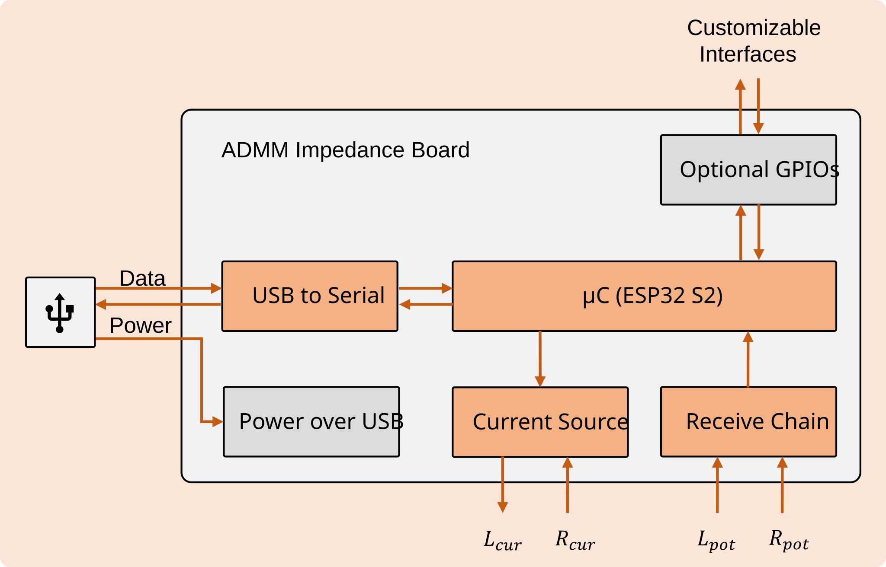
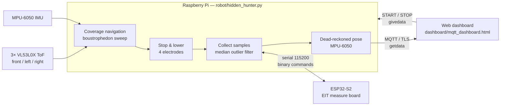
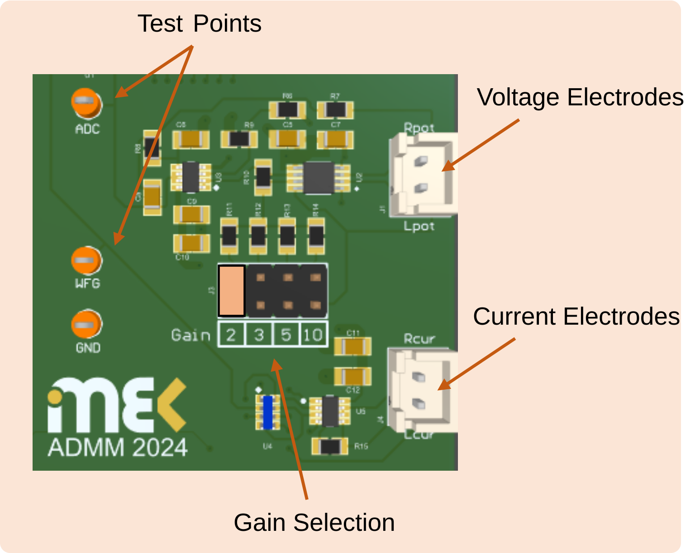
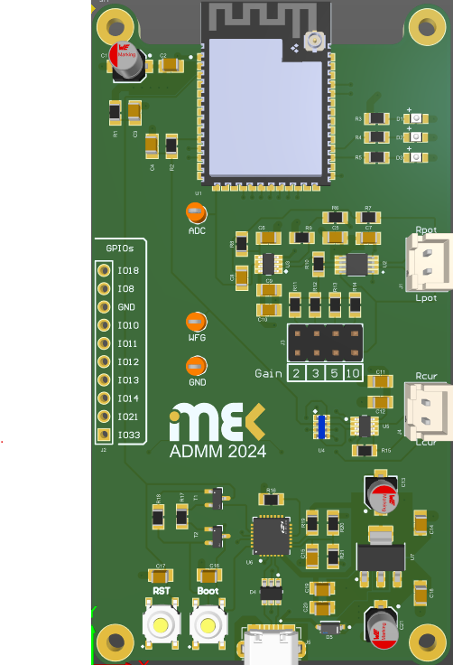
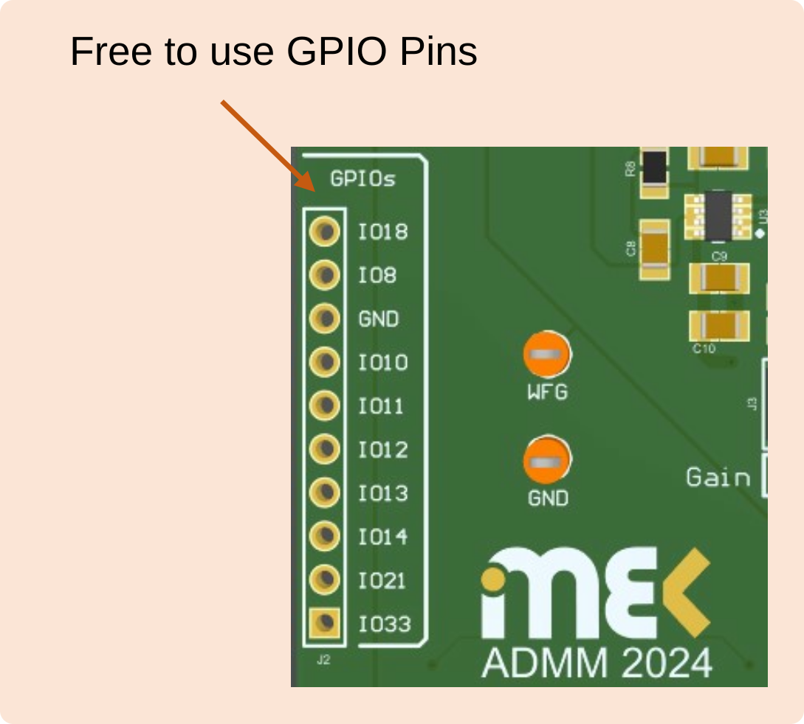

# Hidden Hunter — Autonomous Buried-Object Detection with EIT

<p align="center">
  
</p>

<p align="center">
  
  
  
  
</p>

A four-wheel ground robot that sweeps a bounded field and detects objects buried **up to 50 mm deep** in soil using
**Electrical Impedance Tomography (EIT)**. At each stop it lowers four servo-driven electrodes into the ground,
a custom **ESP32-S2 measurement board** injects a controlled AC current and measures the response, and the
Raspberry Pi publishes impedance readings tagged with the robot's estimated position to a live web dashboard over MQTT.

Built as a group project (ADMM 2024, Group B) at the **Institute of Mechatronics in Mechanics (M4), Hamburg University of Technology**.

---

## How it works



1. **Coverage navigation** — the robot drives forward while three VL53L0X time-of-flight sensors (EMA-filtered) watch for
   the field boundary. At a wall it turns 90°, steps over one lane, and turns 90° again, alternating direction each
   time to sweep the area lane by lane. Turns are closed-loop on the MPU-6050 gyro.
2. **EIT measurement** — at every stop, four servos press the electrodes into the soil. The Pi configures the ESP32-S2
   (excitation frequency, current, measurement duration) over a small binary serial protocol, triggers a measurement,
   collects samples, and rejects outliers around the median.
3. **Localisation** — readings are tagged with an IMU dead-reckoned (x, y) position, clamped to the field size.
4. **Telemetry & control** — results are published over MQTT with TLS; the browser dashboard shows them live and sends
   `START` / `STOP` commands back to the robot.

## Hardware

| Subsystem | Components |
|---|---|
| Compute | Raspberry Pi (motion, sensing, MQTT), ESP32-S2 custom PCB (EIT excitation + measurement) |
| Drive | 4 DC motors with PWM speed control |
| Sensing | 3× VL53L0X ToF (I²C, re-addressed via XSHUT), MPU-6050 IMU |
| Electrodes | 4 servo-actuated soil electrodes |
| Link | USB serial (Pi ↔ ESP32), MQTT over TLS (Pi ↔ dashboard) |

<p align="center">
  
  
</p>
<p align="center"></p>

### Pi ↔ ESP32 command set

| Command | Code | Purpose |
|---|---|---|
| `SET_FREQ_HZ` / `GET_FREQ_HZ` | `0xA1` / `0xB1` | excitation frequency |
| `SET_CURRENT_UA` / `GET_CURRENT_UA` | `0xA2` / `0xB2` | injected current (µA) |
| `SET_MEASURE_DURATION` / `GET_…` | `0xA3` / `0xB3` | measurement window |
| `START_MEASUREMENT` | `0xA4` | trigger a measurement |
| `GET_IMPEDANCE` | `0xB4` | read the result |

Defined in [`esp32/esp32s2-measure-board/src/commands.h`](esp32/esp32s2-measure-board/src/commands.h).

## Repository layout

```
robot/
  hidden_hunter.py          main program: navigation + EIT + MQTT (run this)
  modular/                  the same robot split into classes (state machine, motion, servos, ToF, EIT)
esp32/
  esp32s2-measure-board/    PlatformIO firmware for the EIT measurement board
  esp32-devboard-tests/     bring-up tests on a dev board
dashboard/
  mqtt_dashboard.html       live web dashboard (MQTT over WebSockets)
hardware_tests/             standalone tests: ToF, IMU calibration, motors, servos, GPIO, serial, MQTT
docs/                       system diagrams, GPIO map, PCB render
archive/                    development iterations kept for reference
```

## Getting started

**Firmware** — flash the measurement board with [PlatformIO](https://platformio.org/):

```bash
cd esp32/esp32s2-measure-board
pio run --target upload
```

**Robot** — on the Raspberry Pi (I²C and serial enabled):

```bash
git clone https://github.com/ookkshirsagar/Autonomous-Object-Detection-Robot-using-EIT.git
cd Autonomous-Object-Detection-Robot-using-EIT
python3 -m venv .venv && source .venv/bin/activate
pip install -r requirements.txt

cp .env.example .env        # fill in your MQTT broker credentials
set -a && source .env && set +a
python3 robot/hidden_hunter.py
```

**Dashboard** — open `dashboard/mqtt_dashboard.html`, set your broker host and credentials in the
`MQTT_*` constants at the top of its script, then press **START**.

> Credentials are read from environment variables (`MQTT_BROKER`, `MQTT_USERNAME`, `MQTT_PASSWORD`) and are never
> stored in the repository.

## Acknowledgements

Thanks to the **Institute of Mechatronics in Mechanics (M4), Hamburg University of Technology** for supervision and support.
